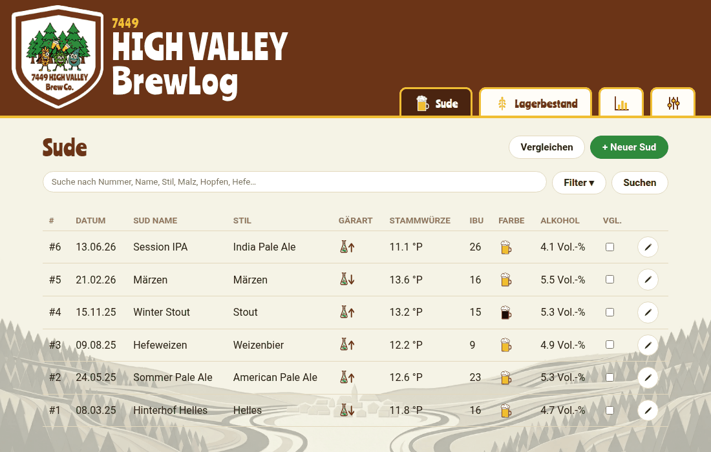
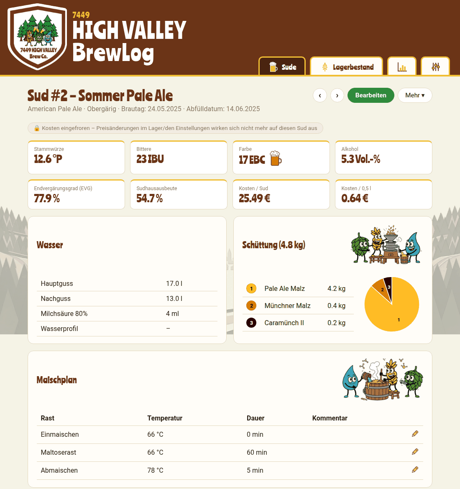
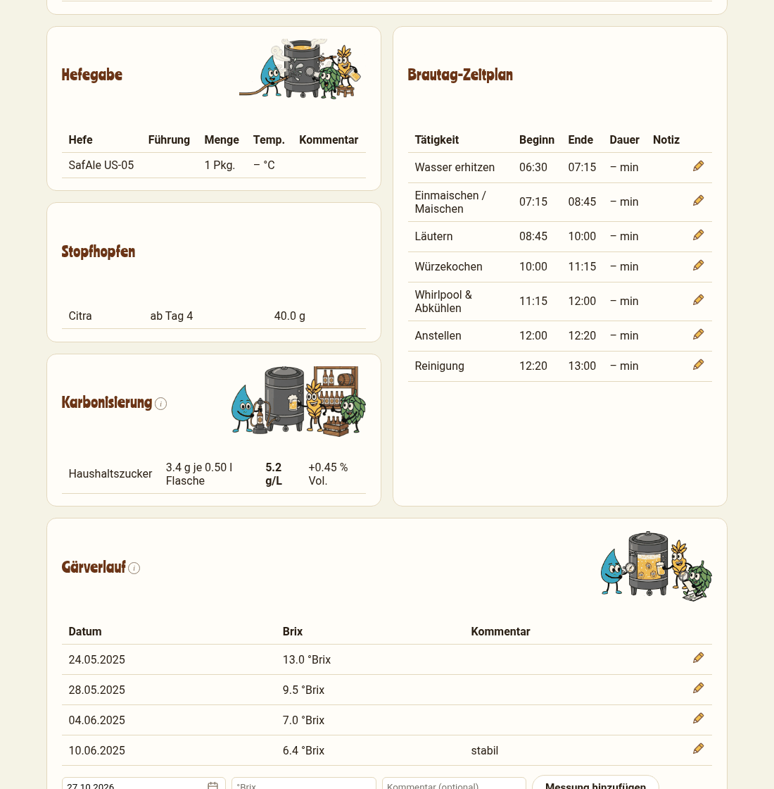
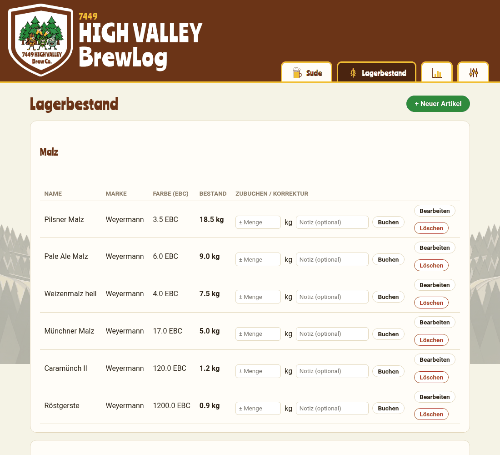
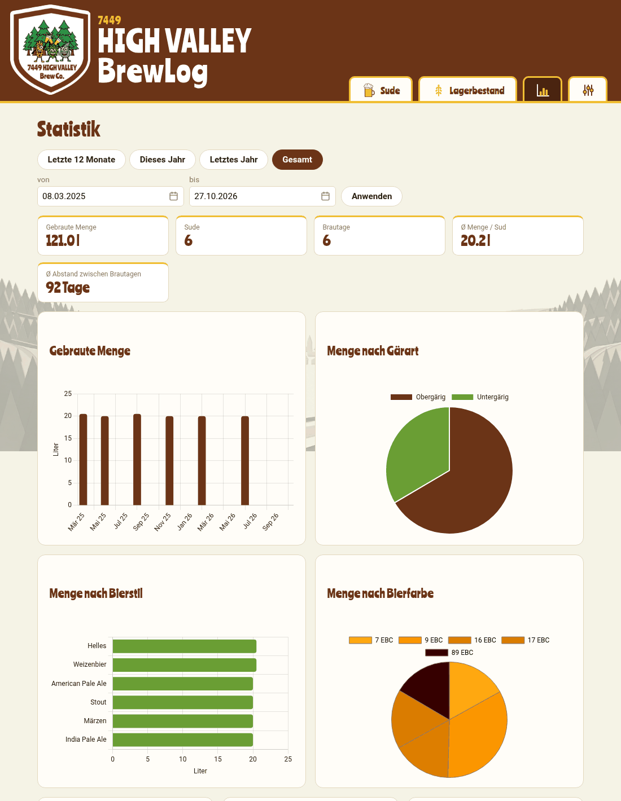
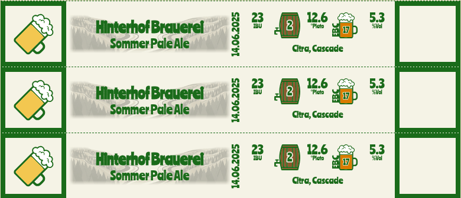
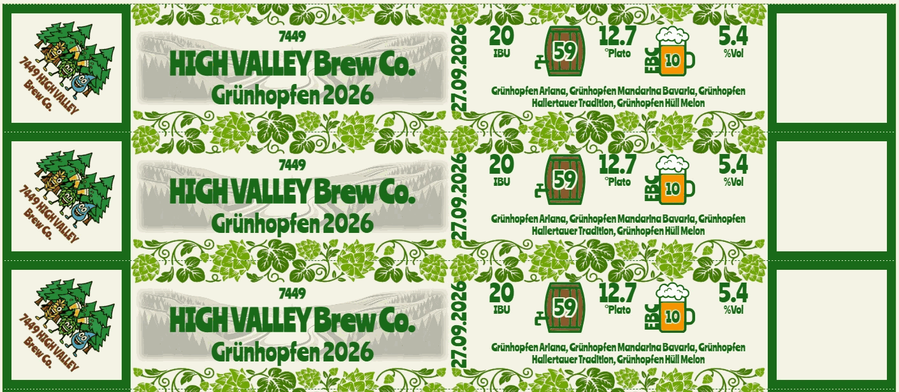
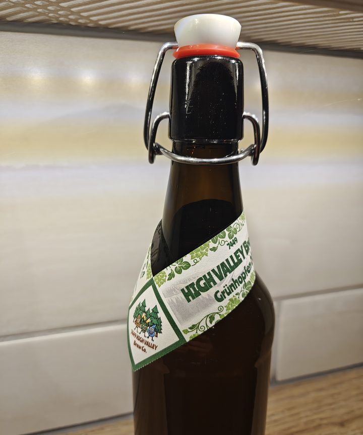
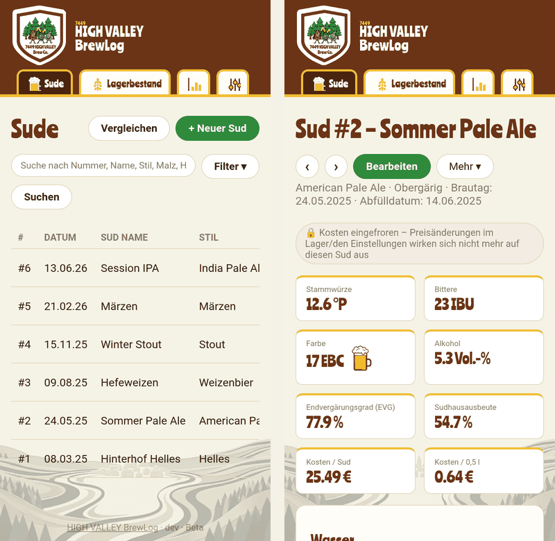

# HIGH VALLEY BrewLog

**Das Brauprotokoll für Hobbybrauer zum Selbsthosten:** Sude, Rezeptkennzahlen,
Lagerbestand, Statistik und Wickel-Etiketten in einer Web-App - läuft als
Docker-Container auf dem eigenen Rechner oder der NAS, bedienbar von jedem
Gerät im Heimnetz (auch als App auf dem Handy). Deine Daten bleiben bei dir:
eine SQLite-Datei, kein Cloud-Konto, keine Werbung.

> **Beta-Version.** Die App befindet sich in der Beta: Funktionen und
> Datenbankstruktur können sich noch ändern - vor jedem Update `./data`
> sichern (siehe [Backup](#version-wählen-und-updates-einspielen)). Alle
> Berechnungen (IBU, Alkohol, Bierfarbe, CO₂, Kosten) sind Näherungen und
> ersetzen keine eigene Messung; Nutzung auf eigene Verantwortung, ohne Gewähr.



*(Alle Screenshots zeigen erfundene Demo-Daten.)*

## Was dich erwartet

### Sude festhalten

Ein Sud pro Datensatz - von der Planung bis zum fertigen Bier: Stammdaten,
Wasser (inkl. Wasserprofile), Schüttung mit Tortendiagramm, Maischplan,
Läuterung, Würzekochen mit Hopfengaben, Hefegabe, Stopfhopfen,
Karbonisierung (Flasche und Fass), Gärverlauf, Brautag-Zeitplan und
Kommentare. Fast alles lässt sich direkt in der Sud-Ansicht per Stift-Symbol
ändern. Sude lassen sich kopieren, vergleichen und als **BeerXML**
importieren/exportieren.





### Kennzahlen, die sich selbst berechnen

Stammwürze, Bittere (IBU, Tinseth), Alkohol und Vergärungsgrad
(Refraktometer-Korrektur nach Sean Terrill), Bierfarbe (EBC, Morey) mit
passender Bierfarbe im Symbol, Sudhausausbeute, Kosten je Sud und je
Flasche sowie CO₂-/Zuckerberechnung für die Karbonisierung. Die Formeln
stehen mit Quellenangabe in `app/formulas.py`.

### Lagerbestand mit automatischer Abbuchung

Malz, Hopfen, Hefe und Sonstiges mit Marke, Alphasäure, Eigenfarbe und Preis.
Zutaten im Sud mit einem Lagerartikel verknüpfen - der Bestand wird beim
Speichern automatisch abgebucht (Details unter
[Automatische Lagerabbuchung](#automatische-lagerabbuchung)).



### Statistik und Reichweite

Gebraute Menge, Verteilung nach Gärart, Bierstil und Bierfarbe, Top-Zutaten,
Bitterkeit vs. Stammwürze, Braurhythmus (Bierstil × Monat) und eine
**Reichweiten-Prognose** für deinen Lagerbestand mit Bestellempfehlung.



### Etiketten zum Ausdrucken

Pro Sud ein A4-Blatt mit Wickel-Etiketten: Name, Datum, IBU, Stammwürze,
Alkohol, Bierfarbe und Hopfensorten werden automatisch eingetragen. Logo,
Rahmengrafik, Hintergrundbild und Farben (auch dunkle Variante für Stout)
stellst du je Sud oder als Standard in den Einstellungen ein - eigene Bilder
lassen sich hochladen.



Mit eigenem Logo, Rahmengrafik (Hopfenranke) und Hintergrundbild sieht dasselbe
Etikett so aus - hier mit eigenem Sudnamen und automatisch eingetragenen
Hopfensorten:



Und so sieht das ausgedruckte, um die Flasche geklebte Etikett aus:



### Auch am Handy

Die Oberfläche passt sich dem Bildschirm an und lässt sich wie eine App
installieren ([Hinweis zu HTTPS](#als-app-installieren-pwa)) - praktisch am
Brautag, um Messwerte direkt einzutragen.



### Außerdem

- **Einstellungen:** Durchschnittskosten für Malz/Hopfen/Hefe, Lohnkosten,
  Refraktometer-Korrekturfaktor, Malz-Extraktausbeute, Bierstile,
  Wasserprofile und eine Standard-Vorlage für den Brautag-Zeitplan
- **Zugriffsschutz** per Benutzername/Passwort (Pflicht), CSRF-Schutz und
  Upload-Limit - siehe [Sicherheit](#deployment-auf-der-synology-nas-docker--container-manager)
- **Dein Daten-Ordner:** alles liegt in einem Verzeichnis (`./data`) und lässt
  sich mit einer Kopie sichern

## Schnellstart

Voraussetzung: [Docker](https://docs.docker.com/get-docker/) mit Docker
Compose.

1. `docker-compose.yml` und `.env.example` aus diesem Repository in einen
   leeren Ordner legen, `.env.example` in `.env` umbenennen
2. In der `.env` ein eigenes Passwort setzen: `APP_PASSWORD=...`
   (**Pflicht** - ohne eigenes Passwort startet die App nicht)
3. Starten:
   ```bash
   docker compose pull
   docker compose up -d
   ```
4. Im Browser öffnen: `http://localhost:5050` (bzw. `http://<IP-des-Rechners>:5050`),
   Benutzername `admin` und dein Passwort

Für Synology NAS, feste Versionen, Updates und Backup siehe
[Deployment](#deployment-auf-der-synology-nas-docker--container-manager).

## Zutaten-Filter in der Sudübersicht

Die Sudübersicht hat ein Dropdown-Filtermenü ("Filter"), in dem Zutaten aus
dem Lagerbestand per Checkbox ausgewählt werden können (Mehrfachauswahl).
Nach Klick auf "Suchen" werden nur Sude angezeigt, die **alle** angehakten
Zutaten enthalten (Kombinationssuche, keine Oder-Verknüpfung).

Der Filter erkennt eine Zutat in einem Sud nur über die Verknüpfung mit dem
Lagerartikel (`inventory_item_id`), nicht über den Namenstext. Diese
Verknüpfung entsteht automatisch, wenn eine Zutatzeile im Sud-Formular über
das jeweilige Dropdown (statt nur als Freitext) ausgewählt wird. Für Sude
ohne diese Verknüpfung (Zutat nur als Freitext eingetragen) liefert der Filter
kein Ergebnis, auch wenn der Name augenscheinlich übereinstimmt - die Zutat
im Sud-Formular dann einfach über das Dropdown auswählen.

## Automatische Lagerabbuchung

Beim Speichern eines Suds (Anlegen **und** Bearbeiten) wird der
Lagerbestand automatisch angepasst, ohne dass dafür ein separater Schritt
nötig ist:

- **Voraussetzung ist die Verknüpfung**: Nur wenn eine Zutatzeile im
  Sud-Formular (Schüttung, Würzekochen/Hopfengaben, Stopfhopfen, Hefegabe)
  über das jeweilige Dropdown mit einem konkreten Lagerartikel verknüpft
  ist, wird davon auch etwas abgebucht. Ein reiner Freitext-Name ohne
  Verknüpfung bucht nichts ab.
- **Abbuchung beim Speichern**: Malz in kg, Hopfen/Stopfhopfen in g und
  Hefe in der jeweils hinterlegten Einheit werden vom Bestand des
  verknüpften Lagerartikels abgezogen.
- **Idempotent beim Bearbeiten**: Beim erneuten Speichern eines bereits
  bestehenden Suds werden zunächst alle bisherigen Buchungen dieses Suds
  vollständig zurückgebucht und danach anhand der aktuellen Zutatenliste
  neu gebucht (`app/inventory.py`, `sync_batch_deductions`). Ein Sud lässt
  sich also beliebig oft bearbeiten, ohne dass der Lagerbestand
  "wegdriftet".
- **Rückbuchung beim Löschen**: Wird ein Sud gelöscht, werden alle seine
  Abbuchungen ebenfalls automatisch rückgängig gemacht.
- **Nachvollziehbarkeit**: Jede Buchung (manuelle Zubuchung wie auch
  automatische Abbuchung durch einen Sud) landet im Buchungsverlauf des
  jeweiligen Lagerartikels (`/inventory/{id}`), inklusive Verweis auf den
  betroffenen Sud.
- **Lagerbuchung sperren**: Ein Sud lässt sich im Formular über die
  Checkbox "Lagerbuchung für diesen Sud sperren" von der automatischen
  Ab-/Rückbuchung ausnehmen (🔒-Kennzeichen auf der Sud-Detailseite).
  Gedacht für historische, bereits abgeschlossene Sude (z.B. nachträglich
  erfasste): ohne diese Sperre würde ein späteres Bearbeiten (und sei es nur
  eine Kleinigkeit) den aktuellen Bestand rückwirkend um die damals
  verwendete Menge reduzieren, obwohl die Zutaten längst real verbraucht
  wurden. Bereits vorhandene Buchungen des Suds werden beim Setzen der
  Sperre zurückgebucht; beim Entfernen der Sperre greift die automatische
  Abbuchung beim nächsten Speichern wieder normal.

## Lokale Entwicklung

```bash
python3 -m venv .venv
source .venv/bin/activate
pip install -r requirements.txt
export DATA_DIR=./data
python run.py
```

Die Oberfläche ist danach unter `http://localhost:5000` erreichbar
(Login über die Umgebungsvariablen `APP_USERNAME` (Standard `admin`) und
`APP_PASSWORD` - **Pflicht**: ohne eigenes Passwort startet die App nicht.
Für lokales Entwickeln: `export APP_PASSWORD=<passwort>` oder
`APP_ALLOW_INSECURE_DEFAULTS=1`).

## Deployment auf der Synology NAS (Docker / Container Manager)

`docker-compose.yml` nutzt standardmäßig ein fertiges Image von GitHub
(`ghcr.io/macgaiser/highvalley-brewlog`, Version wählbar über
`BREWLOG_VERSION`, siehe unten) statt lokal aus dem Code zu bauen. Auf der NAS wird also nur die `docker-compose.yml` (und `.env`)
benötigt, kein vollständiges Repository.

1. Nur die Datei `docker-compose.yml` (z.B. per File Station) in einen
   eigenen Ordner auf die NAS legen, z.B. `/docker/highvalley-brewlog/`
2. `.env.example` aus dem Repository herunterladen, nach `.env` umbenennen,
   Zugangsdaten anpassen und in denselben Ordner legen (oder die Werte
   direkt in `docker-compose.yml` eintragen)
3. In diesem Ordner:
   ```bash
   docker compose pull
   docker compose up -d
   ```
   Alternativ über die Synology **Container Manager**-Oberfläche: Projekt
   anlegen und den `docker-compose.yml`-Inhalt einfügen.
4. Die App ist danach unter `http://<NAS-IP>:5050` erreichbar (Port ist in
   `docker-compose.yml` frei anpassbar).

### Version wählen und Updates einspielen

Ohne Angabe läuft immer der **neueste Stand** (`latest`). Für Tester (und
alle, die keine halbfertigen Änderungen wollen) ist eine **feste Version**
besser: in der `.env` z.B. `BREWLOG_VERSION=v1.1.0-beta.1` setzen (verfügbare
Versionen: Reiter *Releases* bzw. *Packages* auf GitHub). Ein Update ist dann
eine bewusste Entscheidung:

```bash
# 1. Daten sichern (siehe "Backup" unten)
# 2. neue Version in der .env eintragen, dann:
docker compose pull
docker compose up -d
```

**Backup:** Vor jedem Update den kompletten Ordner `./data` kopieren (enthält
die SQLite-Datenbank und hochgeladene Bilder), z.B.
`cp -r data data-backup-$(date +%F)`. Zurückgehen: Container stoppen
(`docker compose down`), den Ordner `data` durch die Sicherung ersetzen, die
alte Version in der `.env` eintragen, `docker compose up -d`. Neue Versionen
ergänzen die Datenbank beim Start automatisch um neue Spalten, ein Zurück auf
eine ältere Version nach einem Update ist daher nur mit der Sicherung sicher.

### Optional: automatische Updates (Watchtower)

Für den eigenen Server kann zusätzlich **Watchtower** laufen
(`docker-compose.watchtower.yml`), das alle 5 Minuten prüft, ob auf GitHub ein
neueres Image liegt, und den Container bei Bedarf automatisch neu zieht und
neu startet:

```bash
docker compose -f docker-compose.yml -f docker-compose.watchtower.yml up -d
```

**Nicht für Tester gedacht:** Watchtower braucht Zugriff auf den Docker-Socket
(praktisch Root-Rechte auf dem Host) und zieht immer den neuesten Stand.

Der Ablauf dahinter (mit Watchtower):
1. Ein Pull Request wird nach `main` gemergt.
2. GitHub Actions (`.github/workflows/docker-publish.yml`) baut daraufhin
   automatisch ein neues Container-Image und lädt es zu **GitHub Container
   Registry** (ghcr.io) hoch.
3. Watchtower auf der NAS bemerkt das neue Image (spätestens nach 5
   Minuten) und aktualisiert den `highvalley-brewlog`-Container
   automatisch. Die Datenbank in `./data` bleibt dabei unangetastet.

**Einmalige Einrichtung, damit die NAS das Image ohne Zugangsdaten laden
kann:** Nach dem ersten erfolgreichen GitHub-Actions-Lauf unter
`github.com/macgaiser/HIGH-VALLEY-BrewLog` → Reiter **"Packages"** →
`highvalley-brewlog` öffnen → **Package settings** → **Change visibility**
→ **Public**. Das Image enthält nur den App-Code, keine Braudaten (die
liegen ausschließlich in `./data` auf der NAS) - "public" ist hier also
unbedenklich. Ohne diesen Schritt bräuchte Watchtower zusätzlich ein
GitHub-Zugangstoken, um das (dann private) Image herunterzuladen.

Falls du stattdessen direkt aus dem Code bauen willst (z.B. für eigene,
noch nicht gemergte Änderungen): `docker-compose.yml` um `build: .`
ergänzen und mit `docker compose up -d --build` statt `pull` starten.

**Persistenz:** Der Ordner `./data` (gemountet nach `/data`) enthält die
komplette SQLite-Datenbank. Diesen Ordner bei Backups berücksichtigen.

**Sicherheit:** Die Oberfläche ist per Benutzername/Passwort (HTTP Basic Auth) geschützt.
`APP_PASSWORD` ist Pflicht (die App startet nicht mit den bekannten
Beispielwerten wie `brewlog` oder `changeme`), `APP_USERNAME` optional. Für einen
Zugriff aus dem Internet (nicht empfohlen) sollte zusätzlich eine
Reverse-Proxy-Konfiguration mit HTTPS (z.B. über die Synology-eigene
Reverse-Proxy-Funktion) und idealerweise VPN-Zugriff verwendet werden.

### Als App installieren (PWA)

BrewLog lässt sich wie eine App auf dem Handy oder Computer installieren
(eigenes Symbol, Vollbild ohne Browserleiste). Dafür bietet der Browser die
Installation aber nur an, wenn die Seite über **HTTPS** (oder auf demselben
Rechner über `localhost`) aufgerufen wird. Unter einer reinen
`http://<IP-Adresse>:Port`-Adresse im Heimnetz erscheint **kein**
Installationsangebot - die App funktioniert dort trotzdem ganz normal im
Browser (ein Lesezeichen oder "Zum Startbildschirm hinzufügen" des Geräts
geht je nach Browser weiterhin).

Für die Installation einen Reverse-Proxy mit HTTPS-Zertifikat vorschalten (z.B.
die Reverse-Proxy-Funktion der Synology mit einem Zertifikat) und die App
darüber aufrufen - siehe auch den Hinweis zu `APP_TRUSTED_ORIGINS` unter
"Sicherheit".

## Tests

```bash
pip install -r requirements.txt -r requirements-dev.txt
pytest
```

Die Tests (`tests/`) prüfen die Berechnungen (IBU, Bierfarbe, Alkohol, Kosten,
Tortendiagramm) und laufen als Rauchtest durch die echte App (Anmeldung, die
wichtigsten Seiten, Sud und Lagerartikel anlegen) - in einem Wegwerf-Ordner,
nie auf echten Daten. Auf GitHub laufen sie bei jedem Pull Request automatisch
(`.github/workflows/tests.yml`).

**CSRF-Schutz:** Ändernde Anfragen (POST usw.) werden nur akzeptiert, wenn sie von
der App selbst kommen (Origin-/Referer-Prüfung gegen den Host der Anfrage, auch
hinter einem Reverse-Proxy per `X-Forwarded-Host`). Hängt die App an einer
anderen als der aufgerufenen Adresse, lassen sich zusätzliche Hosts über die
Umgebungsvariable `APP_TRUSTED_ORIGINS` (kommagetrennt, z.B.
`brew.example.com`) erlauben.

## Projektstruktur

```
app/
  models.py         SQLModel-Datenmodell (Sude, Zutaten, Lagerbestand)
  formulas.py        Brautechnische Berechnungen (IBU, ABV, Ausbeute, ...)
  batch_calc.py       Verknüpft Modell + Formeln zu Sud-Kennzahlen
  inventory.py         Zu-/Abbuchungslogik für den Lagerbestand
  routers/              FastAPI-Routen (Sude, Lagerbestand, Einstellungen)
  templates/             Jinja2-Templates
  static/                  CSS/JS
```

## API-Übersicht (server-gerenderte Seiten, kein separates JSON-API)

Alle Routen (außer `/healthz`) erfordern HTTP Basic Auth.

| Methode | Pfad | Beschreibung |
|---------|------|--------------|
| GET | `/batches` | Sud-Übersicht |
| GET/POST | `/batches/new` | Neuen Sud anlegen |
| GET | `/batches/{id}` | Sud-Detailansicht mit berechneten Kennzahlen |
| GET/POST | `/batches/{id}/edit` | Sud bearbeiten |
| POST | `/batches/{id}/delete` | Sud löschen (bucht Lagerbestand zurück) |
| POST | `/batches/{id}/fermentation` | Gärverlauf-Messung hinzufügen |
| GET | `/inventory` | Lagerbestand-Übersicht |
| GET/POST | `/inventory/new` | Neuen Lagerartikel anlegen |
| GET/POST | `/inventory/{id}/edit` | Lagerartikel bearbeiten |
| POST | `/inventory/{id}/restock` | Bestand zu-/abbuchen |
| GET | `/batches/compare` | Mehrere Sude vergleichen |
| GET | `/batches/{id}/label` | Etikett-Vorschau und -Druck |
| GET | `/batches/{id}/export/beerxml` | Sud als BeerXML exportieren |
| GET | `/statistics` | Statistik und Lager-Reichweite |
| GET/POST | `/settings` | Kosten-, Etiketten- und Berechnungseinstellungen |

## Lizenz

**Bilder, Logos, Symbole und die Marke "HIGH VALLEY" sind nicht Teil dieser
Lizenz:** alle Rechte vorbehalten, keine Weitergabe oder Weiterverwendung -
siehe [LICENSE-ASSETS.md](LICENSE-ASSETS.md). Forks müssen sie durch eigene
Bilder ersetzen.

Mitgelieferte Schriften und Bibliotheken von Drittanbietern (Roboto, Ranchers,
Chart.js, flatpickr) stehen unter eigenen Lizenzen - siehe
[THIRD_PARTY_NOTICES.md](THIRD_PARTY_NOTICES.md).

Der Quellcode steht unter der [Business Source License 1.1](LICENSE)
(BSL) - er ist frei einsehbar und darf kostenlos selbst gehostet werden
(auch per Docker), inkl. Veränderung für den eigenen Gebrauch. Nicht
erlaubt ist ohne Zustimmung des Lizenzgebers, daraus ein eigenes
kommerzielles Produkt (z.B. ein fertig gepackter Installer) zu bauen und
zu verkaufen - siehe die genauen Bedingungen im "Additional Use Grant" der
`LICENSE`-Datei.

Die Lizenz enthält ein **Change Date** (aktuell 2030-09-14), ab dem der zu
diesem Zeitpunkt veröffentlichte Code automatisch unter die freizügigere
MIT-Lizenz fällt. Das BSL-1.1-Regelwerk selbst begrenzt den Schutz pro
Version zusätzlich auf maximal 4 Jahre ab deren Erstveröffentlichung
("whichever comes first"). Bei künftigen größeren Releases wird die
`LICENSE`-Datei entsprechend aktualisiert (neue Versionsnummer + neues
Change Date, wieder max. 4 Jahre in der Zukunft), um den Schutz für den
dann neu hinzugekommenen Code zu verlängern - bereits veröffentlichter
älterer Code bleibt dabei bei seinem ursprünglichen Stichtag.
